# Router-on-a-Stick: Inter-VLAN Routing over a Single Trunk


A Cisco Packet Tracer lab where I route traffic between two VLANs using **one physical router interface**. The switch sends both VLANs to the router over a single 802.1Q trunk, and the router splits them into **subinterfaces**, one per VLAN. This design is called **router-on-a-stick** (ROAS).

> This is the follow-up to my [Inter-VLAN Routing lab](https://github.com/Mark-Hamlin/intervlan-routing-lab), which used one router interface per VLAN. Here the same network uses just one cable between the router and switch.

---

## Table of Contents

1. [Topology](#topology)
2. [Addressing Plan](#addressing-plan)
3. [How Router-on-a-Stick Works](#how-router-on-a-stick-works)
4. [Step 1 – Base Configuration](#step-1--base-configuration)
5. [Step 2 – VLANs, Access Ports, and the Trunk](#step-2--vlans-access-ports-and-the-trunk)
6. [Step 3 – Router Subinterfaces](#step-3--router-subinterfaces)
7. [Step 4 – Testing](#step-4--testing)
8. [Verification Commands](#verification-commands)
9. [Router-on-a-Stick vs. One Interface per VLAN](#router-on-a-stick-vs-one-interface-per-vlan)
10. [Key Takeaways](#key-takeaways)
11. [Next Steps](#next-steps)
12. [Final Configurations](#final-configurations)

---

## Topology

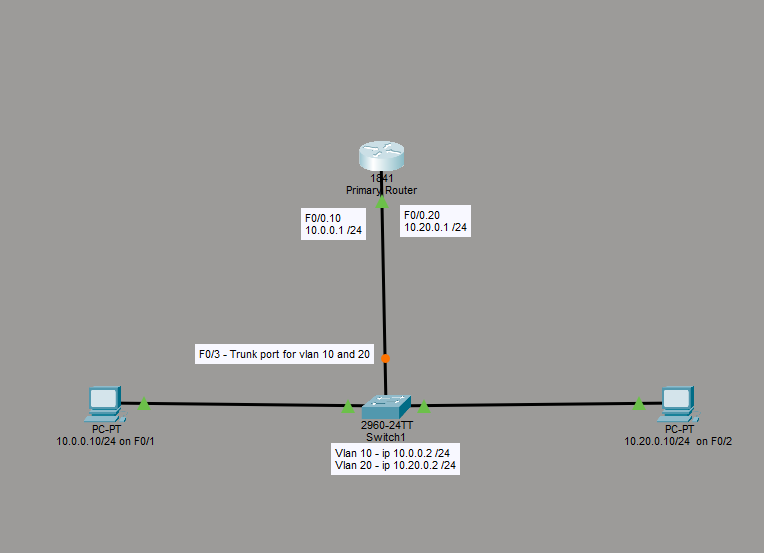

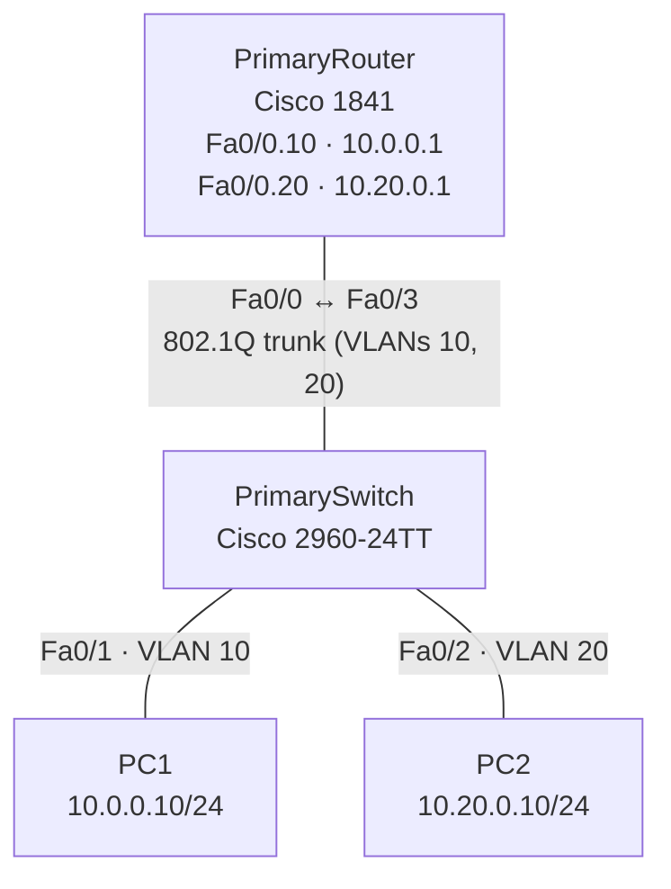

## Addressing Plan

| Device | Interface | IP Address | Subnet Mask | Default Gateway | VLAN |
|---|---|---|---|---|---|
| PrimaryRouter | Fa0/0 | — (no IP, physical trunk link) | — | — | Trunk |
| PrimaryRouter | Fa0/0.10 | 10.0.0.1 | 255.255.255.0 | — | 10 |
| PrimaryRouter | Fa0/0.20 | 10.20.0.1 | 255.255.255.0 | — | 20 |
| PrimarySwitch | VLAN 10 (SVI) | 10.0.0.2 | 255.255.255.0 | 10.0.0.1 | 10 |
| PrimarySwitch | VLAN 20 (SVI) | 10.20.0.2 | 255.255.255.0 | 10.0.0.1 | 20 |
| PC1 | NIC | 10.0.0.10 | 255.255.255.0 | 10.0.0.1 | 10 |
| PC2 | NIC | 10.20.0.10 | 255.255.255.0 | 10.20.0.1 | 20 |

### Switch Port Assignments

| Switch Port | Mode | VLAN | Connected To |
|---|---|---|---|
| Fa0/1 | Access | 10 | PC1 |
| Fa0/2 | Access | 20 | PC2 |
| Fa0/3 | **Trunk** | 10, 20 (allowed) | PrimaryRouter Fa0/0 |
| Fa0/4 – Fa0/24 | Access (shut down) | 30 (unused) | — |
| Gi0/1 – Gi0/2 | Shut down | — | — |

---

## How Router-on-a-Stick Works

Here's what happens when PC1 (VLAN 10) pings PC2 (VLAN 20):

1. PC1 sees that 10.20.0.10 is on a different subnet, so it sends the packet to its **default gateway, 10.0.0.1**.
2. The switch receives the frame on access port Fa0/1 (VLAN 10) and forwards it up the trunk on Fa0/3 with an **802.1Q tag for VLAN 10**.
3. The router sees the VLAN 10 tag and hands the frame to **subinterface Fa0/0.10** (`encapsulation dot1Q 10`).
4. The router checks its routing table, finds 10.20.0.0/24 directly connected on **Fa0/0.20**, and sends the packet back down the same cable with a **VLAN 20 tag**.
5. The switch removes the tag and delivers the frame out access port Fa0/2 to PC2.

The traffic goes up the "stick" and back down it, which is where the name comes from.

---

## Step 1 – Base Configuration

I start by mapping out every device, IP address, and port so I have a reference to check against while testing. Then I put my standard base configuration on both the switch and the router.

### Getting into configuration mode

| Command | Mode you end up in | Purpose |
|---|---|---|
| `enable` (`en`) | Privileged EXEC (`Switch#`) | Full access to every `show`, `debug`, `copy`, and `reload` command, and required before entering configuration mode |
| `configure terminal` (`conf t`) | Global configuration (`Switch(config)#`) | Where configuration changes are made |
| `?` | Any | Lists the commands (or the next keyword) available at that point |

### What the less obvious commands do

| Command | What it does |
|---|---|
| `enable secret <password>` | Sets the privileged EXEC password and stores it as a hash (type 5 / MD5) |
| `username admin secret <password>` | Creates a local user account used by `login local` |
| `ip domain-name marksnetwork.local` | IOS needs a **hostname and a domain name** to name and generate the RSA keys that SSH uses |
| `crypto key generate rsa general-keys modulus 1024` | Generates the RSA key pair that enables SSH. SSH version 2 needs at least 768 bits. |
| `ip ssh version 2` | Allows only SSHv2. After the keys are generated, IOS reports "SSH 1.99", which means it accepts both v1 and v2. This command turns v1 off. |
| `line con 0` | Enters configuration for the **console line**, the physical console port. It's a *line*, not an interface. |
| `login local` | Makes anyone connecting on that line log in with the local username and password |
| `logging synchronous` | Stops log messages from interrupting a command while you type it |
| `line vty 0 4` | Enters configuration for the 5 **virtual terminal lines** (0–4) used for remote sessions |
| `transport input ssh` | Allows only SSH on the VTY lines and blocks Telnet, which sends everything in clear text |

### Switch

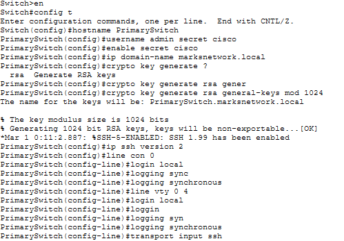

*`crypto key generate ?` shows how the built-in help lists the next keyword you can use.*

### Router

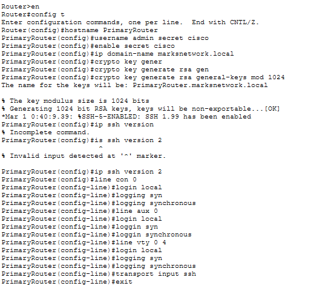

*I misspelled a few commands here. `is ssh version 2` was rejected with `% Invalid input`, and the `^` marker points to where IOS stopped understanding the command. `ip ssh version` with nothing after it gave `% Incomplete command`. Abbreviations like `loggin syn` are fine, because IOS accepts any abbreviation that matches only one command.*

> 🔒 `cisco` is a lab-only password. Never reuse a password that appears in a screenshot.

---

## Step 2 – VLANs, Access Ports, and the Trunk

### Access ports: Fa0/1 → VLAN 10, Fa0/2 → VLAN 20

```cisco
interface FastEthernet0/1
 switchport mode access
 switchport access vlan 10
 switchport nonegotiate
 spanning-tree portfast
!
interface FastEthernet0/2
 switchport mode access
 switchport access vlan 20
 switchport nonegotiate
 spanning-tree portfast
```

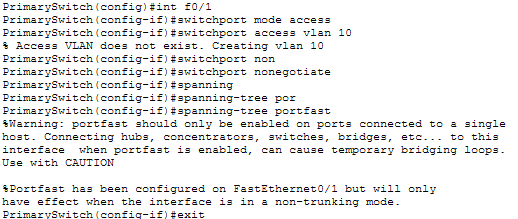

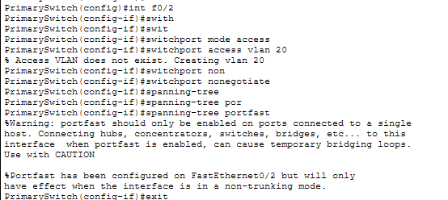

*IOS creates each VLAN automatically the first time a port is assigned to it ("Access VLAN does not exist. Creating vlan 10").*

| Command | What it does |
|---|---|
| `switchport mode access` | Locks the port into access mode so it carries one VLAN, untagged |
| `switchport access vlan 10` | Puts the port in VLAN 10 and creates the VLAN if it doesn't exist |
| `switchport nonegotiate` | Turns off DTP so nothing on the other end can negotiate a trunk, which helps prevent VLAN-hopping attacks |
| `spanning-tree portfast` | Moves the port straight to forwarding without the ~30-second STP delay. Use it only on ports that connect to end devices. |

### Trunk port: Fa0/3 → router

```cisco
interface FastEthernet0/3
 switchport mode trunk
 switchport trunk allowed vlan 10,20
 switchport nonegotiate
```

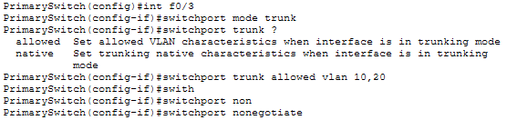

*Using `?` after `switchport trunk` to see the options: `allowed` and `native`.*

| Command | What it does |
|---|---|
| `switchport mode trunk` | Makes the port a trunk. It carries frames from multiple VLANs, each with an 802.1Q tag that identifies its VLAN. |
| `switchport trunk allowed vlan 10,20` | Only VLANs 10 and 20 can cross the trunk. All other VLANs are blocked. |
| `switchport nonegotiate` | Turns off DTP. The trunk is hard-coded, so there's nothing to negotiate. |

**Notes about trunks:**

- **To add a VLAN later, use `switchport trunk allowed vlan add 30`.** Without `add`, the command **replaces** the whole list. `switchport trunk allowed vlan 30` would remove VLANs 10 and 20 from the trunk and cut off both of them.
- **Plain `spanning-tree portfast` does nothing on a trunk.** IOS warns that it "will only have effect when the interface is in a non-trunking mode." There's a separate `spanning-tree portfast trunk` command for trunks that connect to a router or server (never another switch), but it isn't needed in this lab.
- **Native VLAN:** untagged frames on a trunk belong to the native VLAN, which is VLAN 1 by default. Every frame between the switch and router in this lab is tagged, so the native VLAN isn't used. See [Next Steps](#next-steps) for hardening it.

### Switch management interfaces (SVIs)

```cisco
interface Vlan10
 ip address 10.0.0.2 255.255.255.0
 no shutdown
interface Vlan20
 ip address 10.20.0.2 255.255.255.0
!
ip default-gateway 10.0.0.1
```

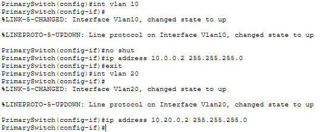

The SVIs use `.2` addresses, because `.1` belongs to the router as the gateway. I learned this the hard way in my [previous lab](https://github.com/YOUR-USERNAME/intervlan-routing-lab), where a duplicate gateway IP on the switch broke routing. On a Layer 2 switch, SVIs are only for managing the switch. They don't route.

### Unused ports → VLAN 30 (and a mistake)

All unused ports get moved out of the default VLAN 1 into an unused VLAN and shut down. A device plugged into a spare port gets no link, and even if the port is re-enabled it's stuck in a VLAN that leads nowhere.

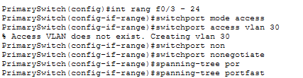

> ⚠️ **Bump:** I started the range at **Fa0/3** (`int range f0/3 - 24`) instead of **Fa0/4**. Fa0/3 is my **trunk to the router**, so `switchport mode access` and `switchport access vlan 30` turned the trunk into an access port in VLAN 30. That cuts the router off from both VLANs, so the PCs can't reach their gateways.
>
> **Fix:** put Fa0/3 back to its trunk configuration and apply the unused-port settings to the correct range:
>
> ```cisco
> interface FastEthernet0/3
>  switchport mode trunk
>  switchport trunk allowed vlan 10,20
>  no spanning-tree portfast
> !
> interface range FastEthernet0/4 - 24
>  switchport mode access
>  switchport access vlan 30
>  switchport nonegotiate
>  shutdown
> ```
>
> **Lesson:** check port assignments with `show interfaces status` or `show vlan brief` before applying a range command, especially when the range sits next to an uplink.

---

## Step 3 – Router Subinterfaces

The router's Fa0/0 is connected to the trunk. Instead of putting an IP on Fa0/0 itself, I split it into one **subinterface per VLAN**:

```cisco
interface FastEthernet0/0
 no ip address
 no shutdown
!
interface FastEthernet0/0.10
 encapsulation dot1Q 10
 ip address 10.0.0.1 255.255.255.0
!
interface FastEthernet0/0.20
 encapsulation dot1Q 20
 ip address 10.20.0.1 255.255.255.0
```

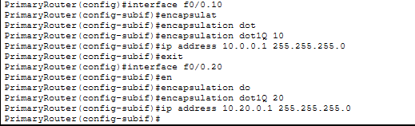

| Command | What it does |
|---|---|
| `interface FastEthernet0/0.10` | Creates subinterface 10 on Fa0/0. The number after the dot is just a label. It **doesn't have to match the VLAN**, but matching it is standard practice and makes the config easier to read. |
| `encapsulation dot1Q 10` | **This** is what links the subinterface to VLAN 10. The router accepts frames tagged with VLAN 10 on this subinterface and tags everything it sends out with VLAN 10. |
| `ip address 10.0.0.1 ...` | The default gateway for VLAN 10. IOS won't let you assign an IP to a subinterface until the encapsulation is configured, so do that first. |
| `no shutdown` on **Fa0/0** | Subinterfaces follow the state of their physical interface. Router interfaces start shut down, so if Fa0/0 is down, every subinterface is down too. |

Once Fa0/0 is up, both subnets show up as **directly connected** routes, and no static routes are needed.

---

## Step 4 – Testing

Final topology, with every link up:


**PC1 (10.0.0.10, VLAN 10):** pings the switch SVI, its gateway, and the router's VLAN 20 gateway.

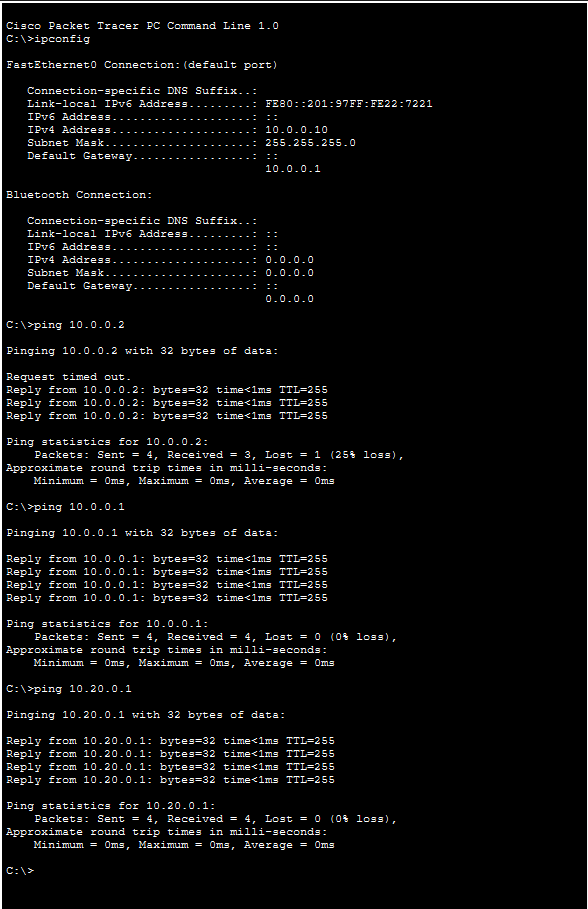

**PC2 (10.20.0.10, VLAN 20):** pings the switch SVI, its gateway, and **PC1 across VLANs**.

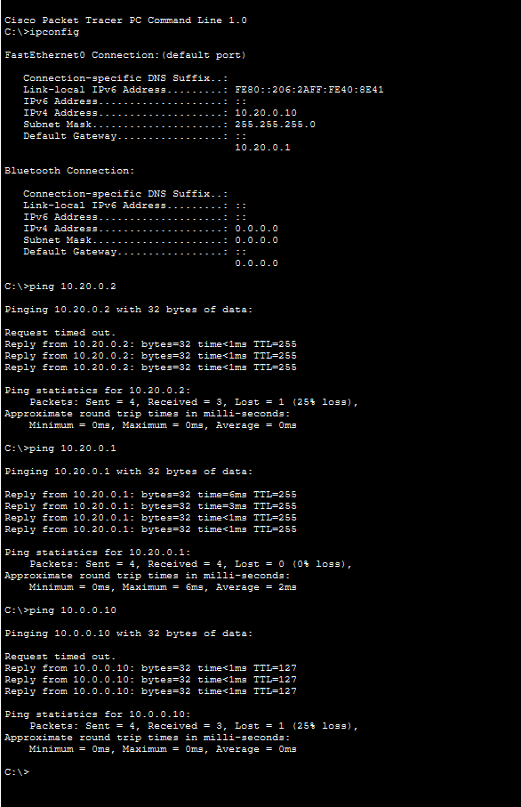

What the results show:

- **PC2 → PC1 works with TTL=127.** PC1 sends the reply with TTL 128, and the router subtracts 1 while routing it from VLAN 10 to VLAN 20. That confirms the traffic was **routed through the router**.
- **Replies from the router and switch show TTL=255**, Cisco's default starting value, because they come from devices on the PC's own subnet.
- **The first ping to a new address times out.** That's normal. The PC (and router) need to resolve MAC addresses with ARP before the first packet can be sent.

---

## Verification Commands

Useful commands for checking a router-on-a-stick setup. The output shown is what a working configuration should look like.

**Switch: is the trunk up, and which VLANs does it carry?**
```
PrimarySwitch# show interfaces trunk

Port        Mode         Encapsulation  Status        Native vlan
Fa0/3       on           802.1q         trunking      1

Port        Vlans allowed on trunk
Fa0/3       10,20

Port        Vlans allowed and active in management domain
Fa0/3       10,20

Port        Vlans in spanning tree forwarding state and not pruned
Fa0/3       10,20
```

**Switch: access port membership**
```
PrimarySwitch# show vlan brief
```
Fa0/3 should **not** appear in this list. Trunk ports aren't listed under any VLAN in `show vlan brief`.

**Router: subinterfaces and routing table**
```
PrimaryRouter# show ip interface brief
Interface            IP-Address   OK? Method Status  Protocol
FastEthernet0/0      unassigned   YES unset  up      up
FastEthernet0/0.10   10.0.0.1     YES manual up      up
FastEthernet0/0.20   10.20.0.1    YES manual up      up
FastEthernet0/1      unassigned   YES unset  administratively down down

PrimaryRouter# show ip route
     10.0.0.0/24 is subnetted, 2 subnets
C       10.0.0.0 is directly connected, FastEthernet0/0.10
C       10.20.0.0 is directly connected, FastEthernet0/0.20
```

**Router: which VLAN each subinterface uses**
```
PrimaryRouter# show vlans
```

### Troubleshooting checklist

1. Can the PC ping the **switch SVI** in its VLAN? This tests the access port and VLAN.
2. Can it ping **its gateway** (the router subinterface)? This tests the trunk and the `encapsulation dot1Q` setting.
3. Can it ping the **other gateway**? This tests routing on the router.
4. Can it ping the **other PC**? This tests the whole path, including the other PC's gateway setting.

---

## Router-on-a-Stick vs. One Interface per VLAN

| | One interface per VLAN ([previous lab](https://github.com/Mark-Hamlin/intervlan-routing-lab)) | Router-on-a-stick (this lab) |
|---|---|---|
| Router ↔ switch cables | One per VLAN | **One in total** |
| Switch ports facing the router | Access ports | **One trunk port** |
| Router config | IP on each physical interface | **Subinterfaces** with `encapsulation dot1Q` |
| Scales to many VLANs? | No. You run out of router ports. | Yes, up to the router's subinterface limit |
| Bandwidth | Each VLAN has its own link | **All inter-VLAN traffic shares one link** (it crosses the link twice) |
| Single point of failure | One link per VLAN | One link for everything |

The next step up is a **Layer 3 switch** with SVIs and `ip routing`, which routes between VLANs in hardware without sending traffic to an external router.

---

## Key Takeaways

- **The subinterface number is a label. `encapsulation dot1Q <vlan>` is what actually assigns the VLAN.**
- **Configure the encapsulation before the IP address.** IOS won't accept an IP on a subinterface until it knows which VLAN the subinterface belongs to.
- **Bring up the physical interface.** Subinterfaces depend on its state.
- **`switchport trunk allowed vlan` replaces the list. Use `add` to add to it.**
- **Double-check `interface range` commands.** One wrong number turned my trunk into an access port.
- **Never give a switch SVI the gateway's IP address.**

## Next Steps

- Move the trunk's **native VLAN** off VLAN 1 to an unused VLAN (for example, 99), using `switchport trunk native vlan 99` on the switch and `encapsulation dot1Q 99 native` on the router. This hardens the trunk against double-tagging VLAN-hopping attacks.
- Give the VLANs names (`vlan 10` → `name USERS`) and add `description` lines to the interfaces.
- Use a single **management VLAN** for the switch instead of SVIs in the user VLANs.
- Rebuild the lab with a **Layer 3 switch** (`ip routing` plus SVIs as gateways).
- Add **DHCP** on the router so the PCs get their addresses automatically (`ip dhcp pool`).

---

## Final Configurations

- [PrimaryRouter.txt](configs/PrimaryRouter.txt): Cisco 1841 router
- [PrimarySwitch.txt](configs/PrimarySwitch.txt): Cisco 2960-24TT switch

> Password hashes are removed from the published configs.
